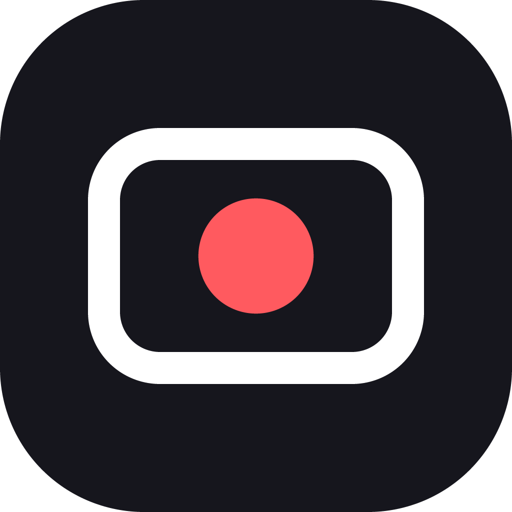
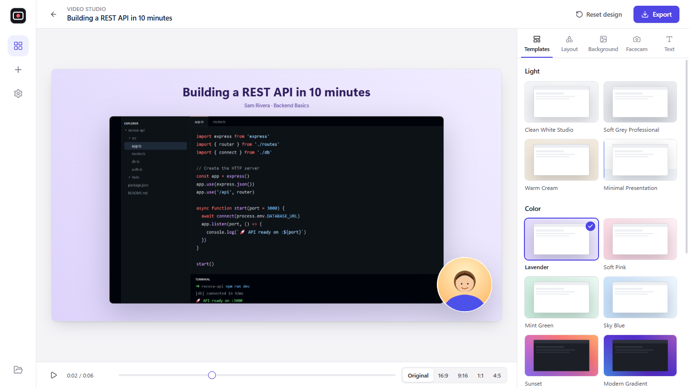
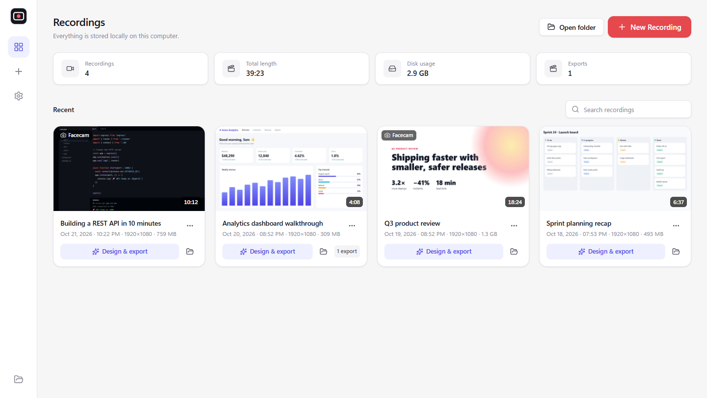
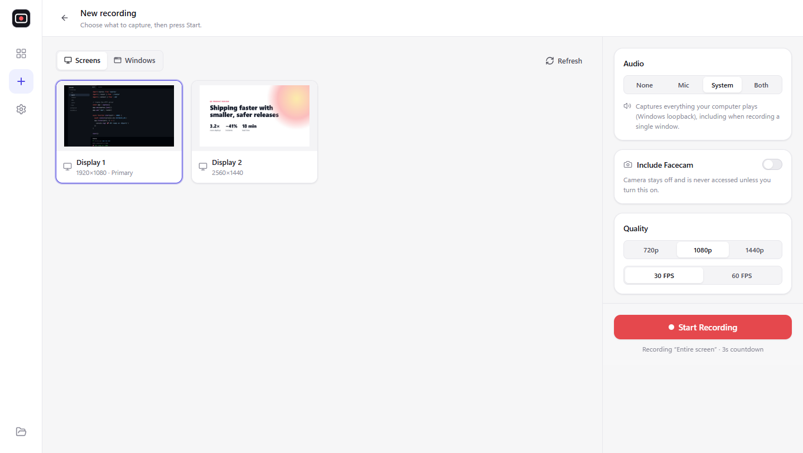
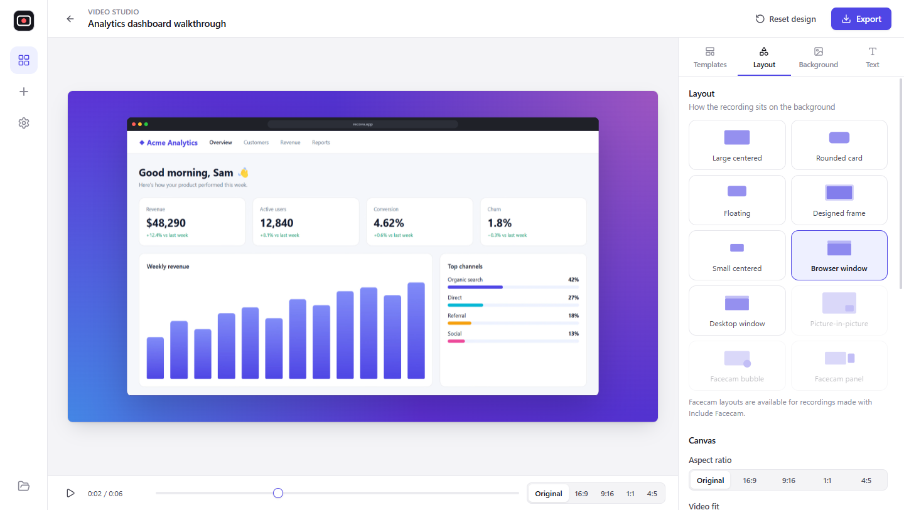
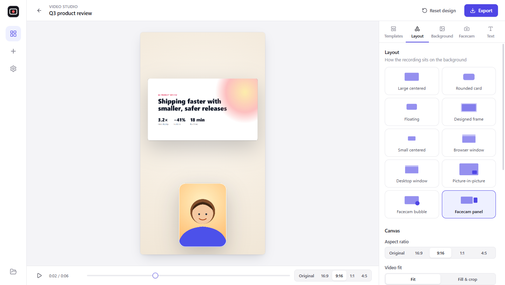
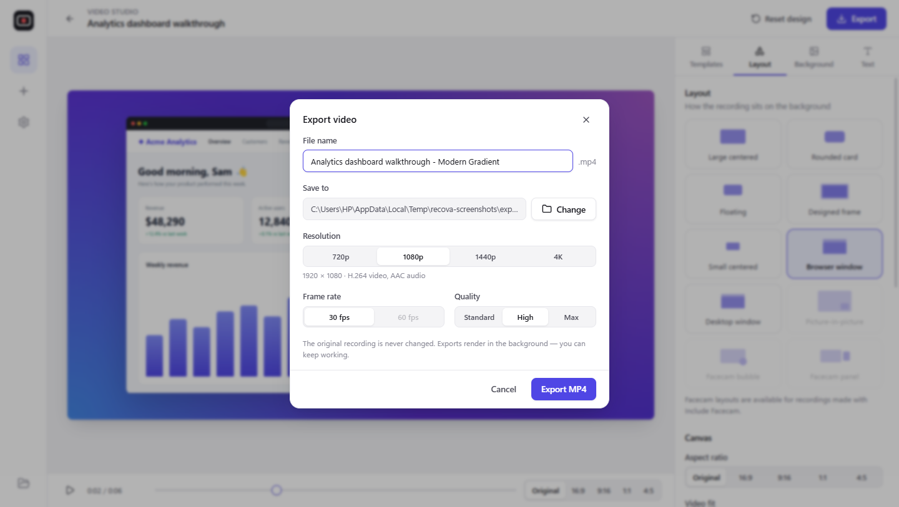
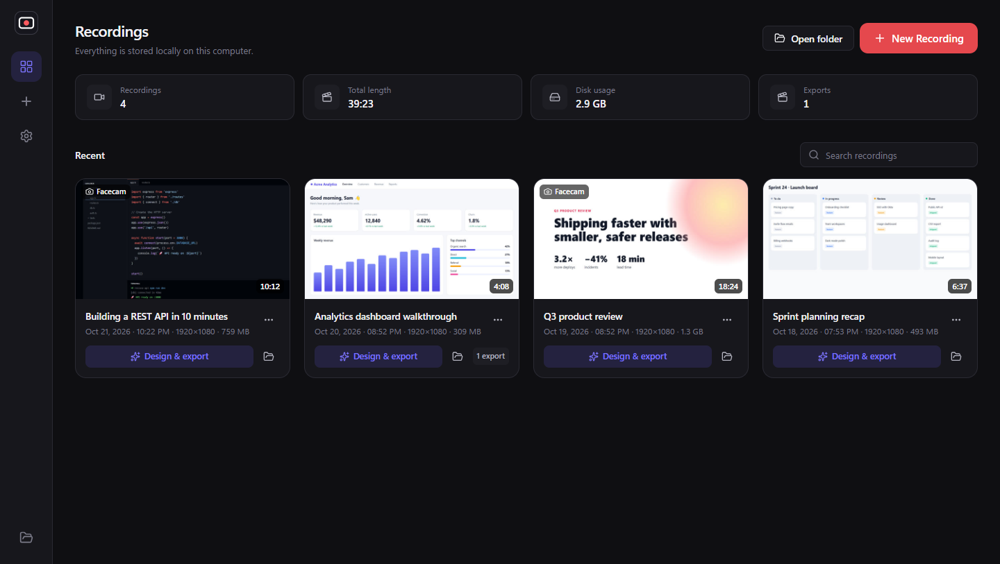

<div align="center">



# Recova

**Record your screen, voice and face, then turn them into beautiful, presentation-ready videos.**

Free, open source and local-first. No account, no cloud, no watermark.

[](https://github.com/miraclemarcel/Recova/releases/latest)
[](https://github.com/miraclemarcel/Recova/actions/workflows/ci.yml)
[](https://github.com/miraclemarcel/Recova/releases)
[](LICENSE)
[](CONTRIBUTING.md)

<br />

<a href="https://github.com/miraclemarcel/Recova/releases/latest/download/Recova-Setup.exe">
  
</a>

<sub>
  Also available for
  <a href="https://github.com/miraclemarcel/Recova/releases/latest/download/Recova-arm64.dmg">macOS (Apple Silicon)</a> ·
  <a href="https://github.com/miraclemarcel/Recova/releases/latest/download/Recova-x86_64.AppImage">Linux (AppImage)</a> ·
  <a href="https://github.com/miraclemarcel/Recova/releases">all releases</a>
</sub>

<br /><br />



</div>

---

## Why Recova?

Most screen recorders give you a plain rectangle of pixels. Recova records your screen and then helps you **present** it: a designed background, a floating video card with soft shadows and rounded corners, a facecam bubble you can drag anywhere, and an optional title. You get a crisp MP4 you can post right away.

Everything runs on your computer. Your recordings are never uploaded.

## Screenshots

<table>
  <tr>
    <td width="50%"><br /><sub><b>Library:</b> all your recordings, stored locally</sub></td>
    <td width="50%"><br /><sub><b>New recording:</b> pick a screen or window, audio, facecam and quality</sub></td>
  </tr>
  <tr>
    <td width="50%"><br /><sub><b>Video Studio:</b> browser-window frame on a modern gradient</sub></td>
    <td width="50%"><br /><sub><b>Any aspect ratio:</b> 9:16 portrait with a separate facecam panel</sub></td>
  </tr>
  <tr>
    <td width="50%"><br /><sub><b>Export:</b> MP4 up to 4K, rendered in the background</sub></td>
    <td width="50%"><br /><sub><b>Dark mode:</b> light, dark or follow the system</sub></td>
  </tr>
</table>

## Features

### 🎥 Recording
- Capture an **entire screen**, a **specific monitor**, or any **application/browser window**, picked from live thumbnails.
- **Microphone**, **system audio** (Windows), **both mixed**, or **none**. Includes a live level meter, a volume control and a 4-second mic test.
- **Optional facecam.** The camera is never opened unless you turn on *Include Facecam*, and it's recorded as its own track so you can restyle it later.
- **720p / 1080p / 1440p** at **30 or 60 FPS**, with a check of what your display can actually deliver.
- **3-2-1 countdown**, a **floating toolbar that's hidden from the recording**, plus **pause / resume / stop / discard**.
- **Crash-safe.** Video is streamed to disk while you record, and interrupted sessions are recovered on the next launch.

### 🎨 Video Studio
- **15 background templates**: clean white studio, soft grey, warm cream, midnight, deep navy, lavender, soft pink, mint, sky blue, sunset, geometric, abstract, modern gradient, developer and presentation.
- **10 layouts**: large centered, rounded card, floating, designed frame, small centered, browser window, desktop window, picture-in-picture, facecam bubble and facecam panel.
- Solid colours, palettes, custom gradients or **your own image** as the background.
- Adjust size, position, padding, corner radius, shadow, border and window chrome.
- **16:9, 9:16, 1:1, 4:5** or the original aspect ratio, with *fit* or *fill & crop* (the video is never stretched).
- **Facecam styling**: circle, rounded or square, size, border, shadow, backing, mirror, and **drag-and-drop positioning**.
- Optional **title, subtitle, creator name and brand label**.
- **Real-time preview** that uses the exact same renderer as the export.

### 📦 Export
- **MP4 (H.264 + AAC)** at 720p, 1080p, 1440p or 4K, 30/60 FPS, with Standard, High or Maximum quality.
- Renders **in the background** with progress, elapsed time, ETA and cancel, so you can keep working.
- Your original recording is **never modified**, so you can export it again with a different design anytime.

### 🔒 Privacy
- No account, no analytics, no telemetry, no uploads.
- Secure Electron setup: context isolation, sandboxed renderer, no Node.js in the UI.

## Installation

| Platform | Download | Notes |
| --- | --- | --- |
| **Windows 10/11** (x64) | [Recova-Setup.exe](https://github.com/miraclemarcel/Recova/releases/latest/download/Recova-Setup.exe) | Run the installer. Windows SmartScreen may warn about an unsigned app. Click **More info → Run anyway**. |
| **macOS** (Apple Silicon) | [Recova-arm64.dmg](https://github.com/miraclemarcel/Recova/releases/latest/download/Recova-arm64.dmg) | Unsigned builds: right-click the app → **Open** the first time. Grant Screen Recording permission in System Settings. |
| **Linux** (x64) | [Recova-x86_64.AppImage](https://github.com/miraclemarcel/Recova/releases/latest/download/Recova-x86_64.AppImage) | `chmod +x Recova-x86_64.AppImage && ./Recova-x86_64.AppImage` |

You don't need to install anything else. FFmpeg and everything else Recova needs is bundled.

> **Windows is the primary platform.** macOS and Linux builds are provided, but some features (system audio, toolbar capture exclusion) are limited there. See [Platform notes](#platform-notes).

## Quick start

1. Click **New Recording**.
2. Pick a screen or window, choose your audio, and optionally turn on **Include Facecam**.
3. Press **Start Recording**. After the countdown, use the floating toolbar to pause, resume or stop.
4. Click **Open in Video Studio**, choose a template and layout, and drag your facecam where you want it.
5. Click **Export**. The MP4 is saved to `Videos/Recova/Exports` (you can change this).

## Building from source

**Requirements:** Node.js **22.6+** (24 recommended) and npm. Windows, macOS or Linux.

```bash
git clone https://github.com/miraclemarcel/Recova.git
cd Recova
npm install        # downloads Electron and the bundled FFmpeg binary
npm run dev        # start with hot reload
```

| Script | Description |
| --- | --- |
| `npm run dev` | Run the app in development mode |
| `npm run typecheck` | Strict TypeScript check (main, preload, renderer) |
| `npm run build` | Typecheck and build production bundles to `out/` |
| `npm run preview` | Run the production build |
| `npm run test:pipeline` | End-to-end FFmpeg composition → MP4 test |
| `npm run test:e2e` | Drives the real app UI: record → Studio → export |
| `npm run screenshots` | Regenerates `docs/screenshots/` from the real app using demo content |
| `npm run dist:win` | Build the Windows installer into `release/<version>/` |
| `npm run dist:mac` / `npm run dist:linux` | Build a DMG / AppImage (run on that OS) |

## How it works

```
src/
├── main/        Electron main process: windows, capture, disk-streamed recording,
│                library + settings (JSON), recova-media:// protocol, FFmpeg export jobs
├── preload/     contextBridge API (window.recova): small, typed, validated
├── shared/      types and constants shared by all processes
└── renderer/    React + Tailwind UI
    └── src/features/
        ├── recording/   source picker, setup screen, MediaRecorder session engine
        ├── audio/       Web Audio mixing, level meter, mic test
        ├── camera/      camera preview
        ├── studio/      composition engine, templates, layouts, live preview
        ├── library/     dashboard, recording cards, player
        ├── export/      export dialog, background progress tray
        ├── settings/    settings screen
        └── toolbar/     floating recording toolbar
```

See **[docs/ARCHITECTURE.md](docs/ARCHITECTURE.md)** for the full design: process model, IPC contract, recording and export pipelines, storage and security.

**Recording:** Recova's picker chooses a `desktopCapturer` source, and the main process answers the renderer's `getDisplayMedia()` (with Windows loopback for system audio). Mic and system audio are mixed with Web Audio. `MediaRecorder` streams WebM chunks to disk over IPC. The facecam goes to its own file. On stop, FFmpeg finalises the files and creates a thumbnail.

**Preview = export:** `features/studio/composition.ts` is a pure layout and Canvas renderer, shared by the preview and the exporter. For export, the static layers (background, shadows, window chrome, borders, text) and the rounded/circular masks are rendered to PNGs at full resolution. FFmpeg then scales and crops the real video, applies the masks with `alphamerge`, stacks the layers with `overlay`, keeps the audio in sync and encodes H.264/AAC. The result is a real composited video, not a preview image laid over the original.

## Platform notes

- **System audio** is Windows-only (Chromium loopback) and captures all system output. On macOS/Linux, use a virtual device (BlackHole, a PipeWire monitor) as the microphone.
- **Toolbar exclusion** uses `setContentProtection` (`WDA_EXCLUDEFROMCAPTURE` on Windows 10 2004+). On Linux, the toolbar may be visible in full-screen captures.
- Screens are captured up to the chosen resolution (never upscaled), and windows at their on-screen size. The achieved resolution and frame rate are saved with each recording.
- Webcam-only recording isn't supported. Every recording needs a screen or window.

## Roadmap

- [ ] Trim start/end in Video Studio
- [ ] Cursor highlight and click effects
- [ ] Auto zoom on activity
- [ ] GIF and WebM export
- [ ] Code-signed installers and auto-update

Ideas welcome. [Open a feature request](https://github.com/miraclemarcel/Recova/issues/new?template=feature_request.yml).

## Contributing

Contributions are very welcome! Read [CONTRIBUTING.md](CONTRIBUTING.md) to get started, and please follow the [Code of Conduct](CODE_OF_CONDUCT.md). For security issues, see [SECURITY.md](SECURITY.md).

For a deep dive into how Recova works, see [docs/ARCHITECTURE.md](docs/ARCHITECTURE.md).

## License

[MIT](LICENSE) © Miracle Marcel and contributors.

Recova bundles [FFmpeg](https://ffmpeg.org) via [ffmpeg-static](https://github.com/eugeneware/ffmpeg-static) (GPL build). Built with [Electron](https://www.electronjs.org), [React](https://react.dev), [Vite](https://vite.dev), [Tailwind CSS](https://tailwindcss.com) and [Lucide](https://lucide.dev).
